<p align="center">
  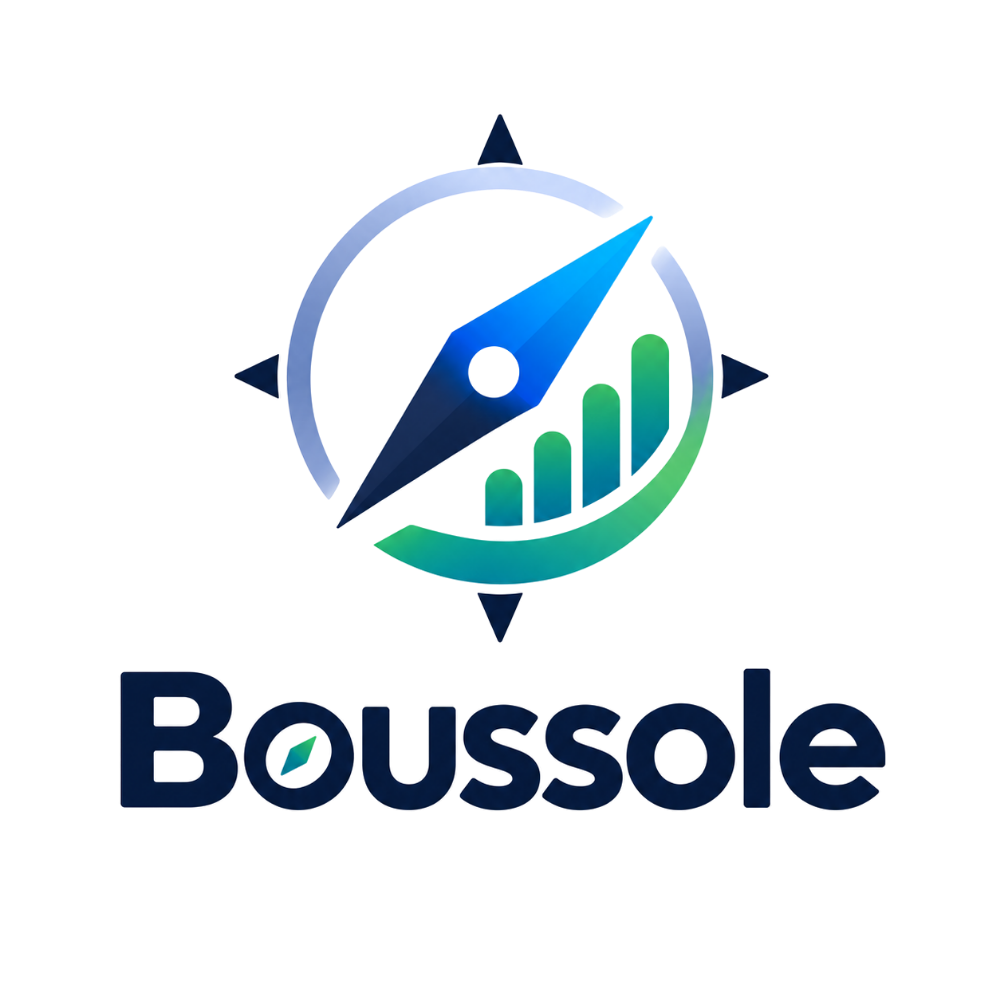
</p>

<h1 align="center">Boussole</h1>
<p align="center"><b>Learn to read the risk of an investment by playing with real market data.</b></p>

> **School project.** Boussole was developed by **Khalil MZOUGHI** in the final year of the
> Engineering degree in Computer Science and Cybersecurity at **INSA Hauts-de-France**
> (module *Compilation and development of mobile applications*, project *Investment Companion*, 2025-2026).
>
> **Important.** The app represents what its developer understood, based on personal experience and
> research. It is educational and informative only: it is **not** a bank, a broker or a financial adviser,
> it gives **no investment advice**, and no real transaction is possible. See [Legal](#13-legal-and-privacy).

<p align="center"></p>

---

## Table of contents

1. [Concept](#1-concept)
2. [Screenshots](#2-screenshots)
3. [Features, one by one](#3-features-one-by-one)
4. [Architecture](#4-architecture)
5. [Project structure](#5-project-structure)
6. [State management](#6-state-management-riverpod)
7. [Data: where it comes from](#7-data-where-it-comes-from)
8. [Data: how it is stored](#8-data-how-it-is-stored)
9. [Cache strategy and offline mode](#9-cache-strategy-and-offline-mode)
10. [Business calculations](#10-business-calculations)
11. [Animations](#11-animations)
12. [Tests](#12-tests)
13. [Legal and privacy](#13-legal-and-privacy)
14. [Run, build and test](#14-run-build-and-test)
15. [Design choices, limits and future work](#15-design-choices-limits-and-future-work)

---

## 1. Concept

A beginner looks at the **return** ("this stock gained 18 % this year") and does not see the **risk**
that comes with it: deep drops, an irregular price, and the importance of the holding period. These ideas
are abstract in a course, but become obvious when you see them on real curves.

**Target user:** an 18-30 year old student or young professional who may invest small amounts
(ETFs, stocks, crypto), has no financial training, likes short playful apps (Duolingo style) and learns
by doing rather than by reading.

After a few sessions the user should be able to answer three questions:

1. How do I recognise a risky asset by looking at its history?
2. Why does the time spent invested change the probability of losing money?
3. What happens if I sell in a panic during a fall?

Boussole answers them with three learning modules built on **real market data** and a catalog of
**30 assets**:

| Module | Question answered | Lesson |
|---|---|---|
| **Guess the curve** (quiz) | Q1 | Recognise risk visually |
| **Risk clock** | Q2 | The investment horizon |
| **Panic button** | Q3 | Drawdown, recovery time, emotional biases |

No account, no bank or broker connection, no tracking. Every number is described as *past* data, never a prediction.

---

## 2. Screenshots

Taken on an iPhone 17 Pro simulator, with real Yahoo Finance data.

<table>
<tr><td align="center" width="25%">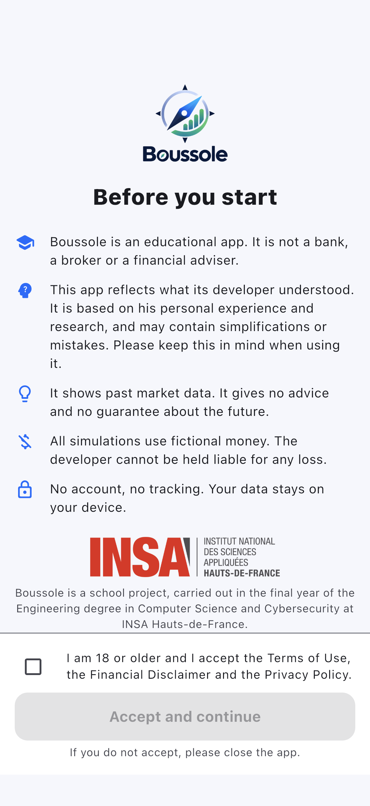<br><sub><b>Legal gate</b></sub></td><td align="center" width="25%">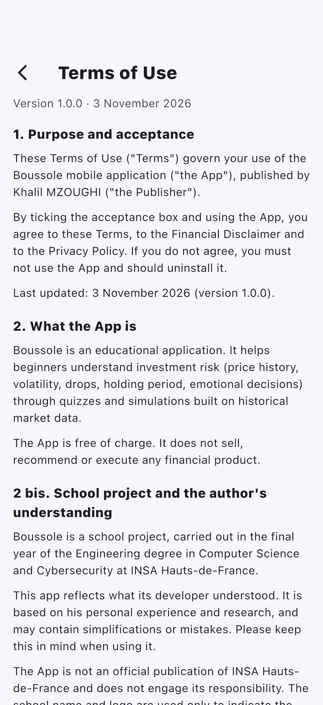<br><sub><b>Terms of Use</b></sub></td><td align="center" width="25%">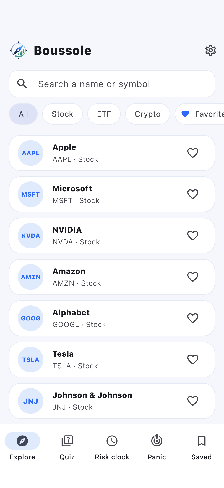<br><sub><b>Catalog</b></sub></td><td align="center" width="25%">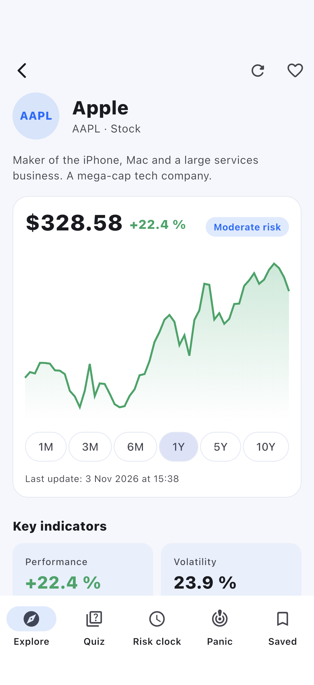<br><sub><b>Asset sheet</b></sub></td></tr>
<tr><td align="center" width="25%">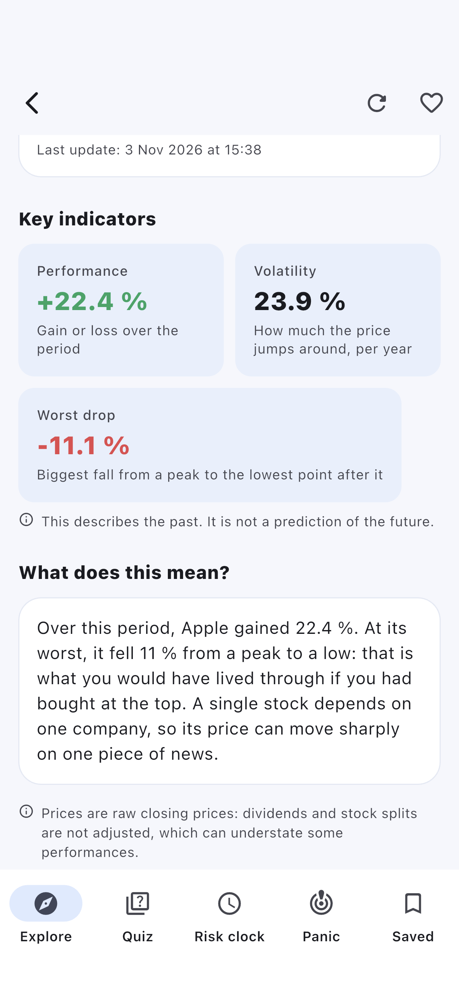<br><sub><b>Indicators</b></sub></td><td align="center" width="25%">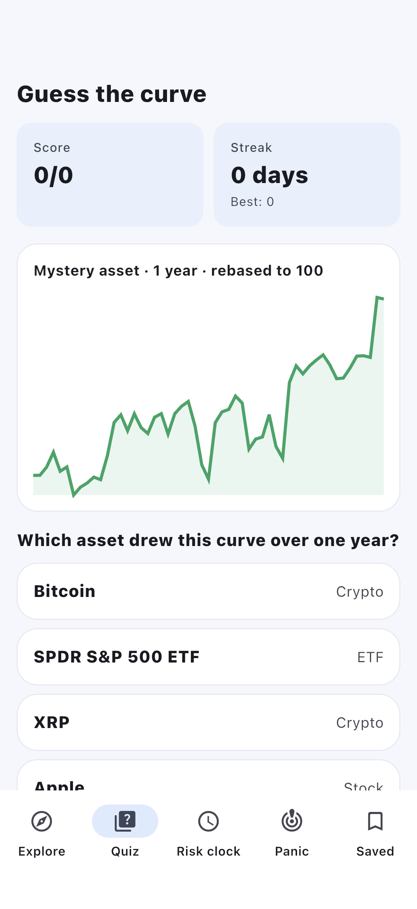<br><sub><b>Quiz: the curve</b></sub></td><td align="center" width="25%">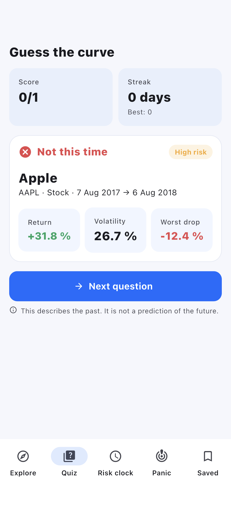<br><sub><b>Quiz: the answer</b></sub></td><td align="center" width="25%">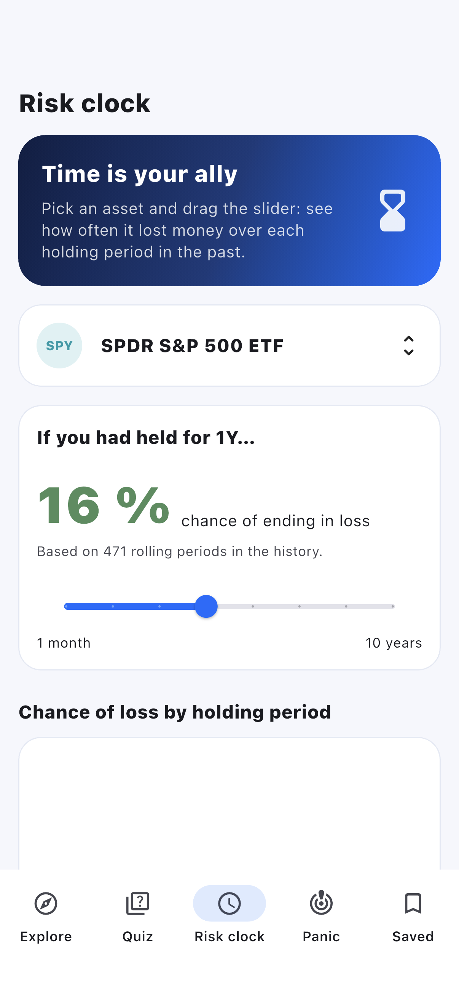<br><sub><b>Risk clock</b></sub></td></tr>
<tr><td align="center" width="25%">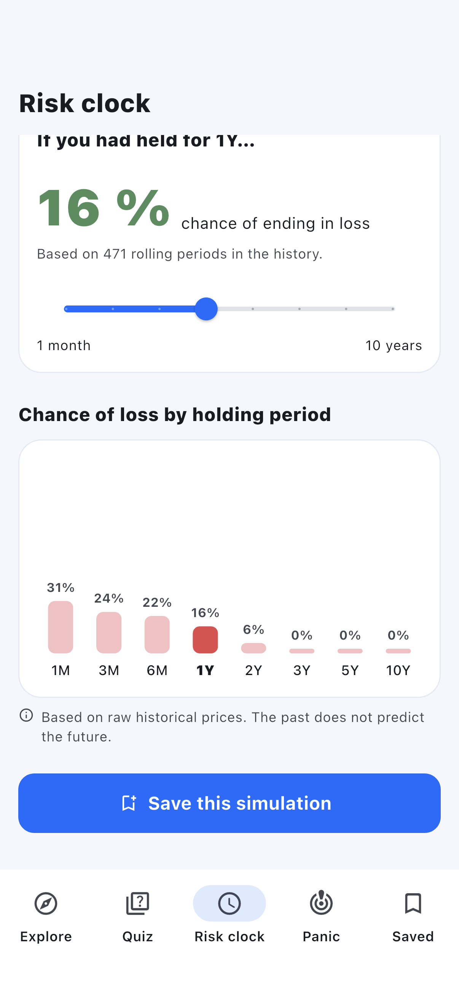<br><sub><b>Loss histogram</b></sub></td><td align="center" width="25%">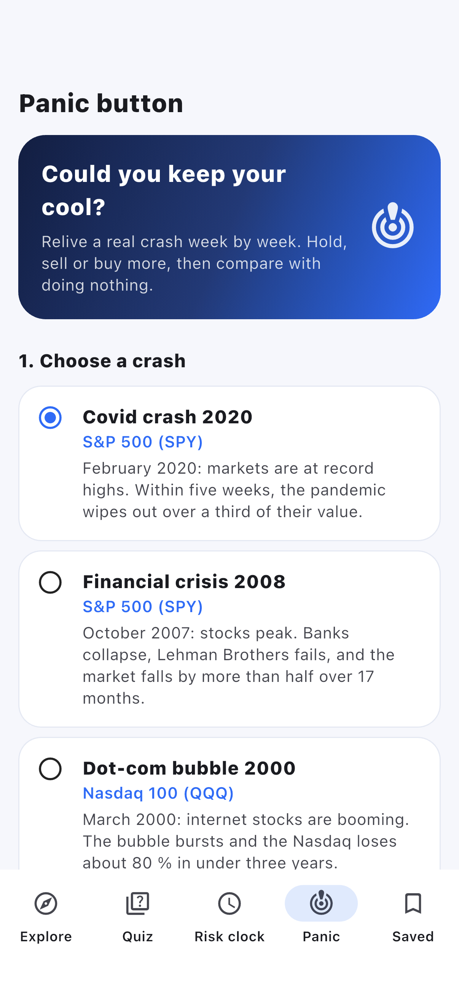<br><sub><b>Panic: setup</b></sub></td><td align="center" width="25%">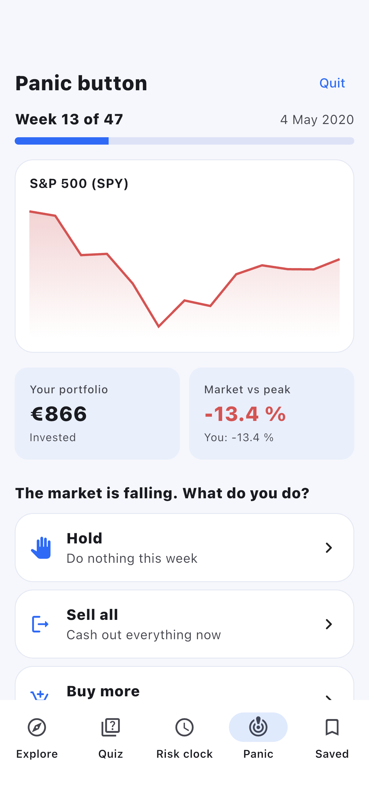<br><sub><b>Panic: playing</b></sub></td><td align="center" width="25%">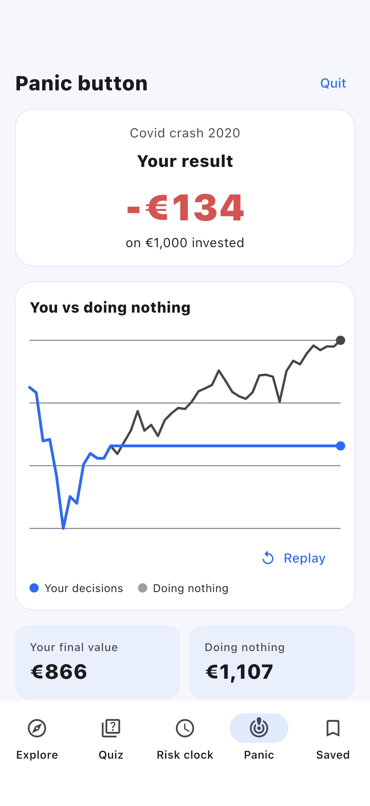<br><sub><b>Panic: result</b></sub></td></tr>
<tr><td align="center" width="25%">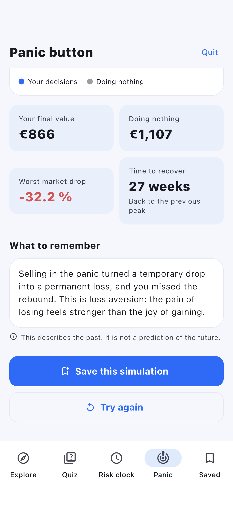<br><sub><b>Result details</b></sub></td><td align="center" width="25%">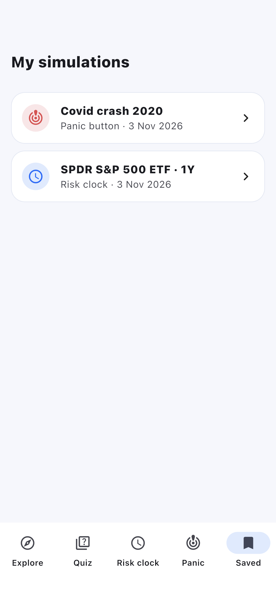<br><sub><b>Saved</b></sub></td><td align="center" width="25%">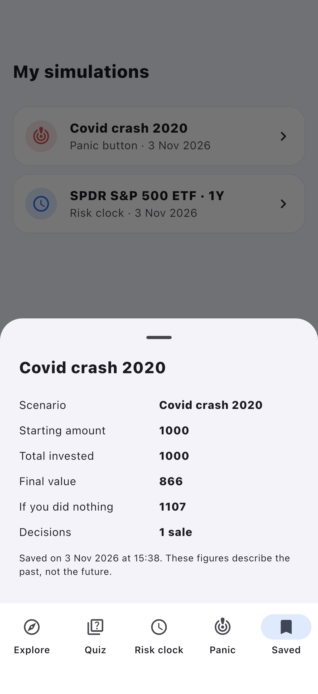<br><sub><b>Saved: details</b></sub></td><td align="center" width="25%">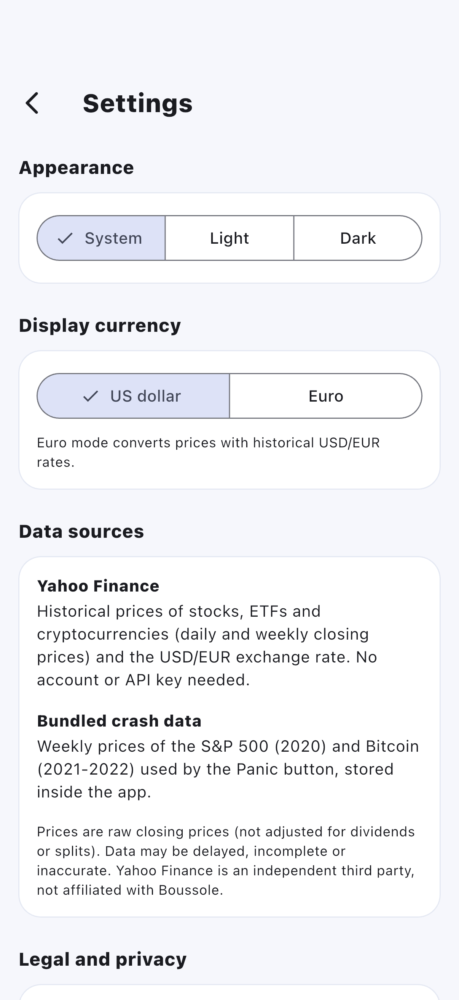<br><sub><b>Settings</b></sub></td></tr>
<tr><td align="center" width="25%">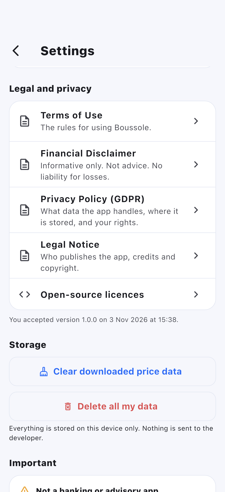<br><sub><b>Settings: legal</b></sub></td><td align="center" width="25%">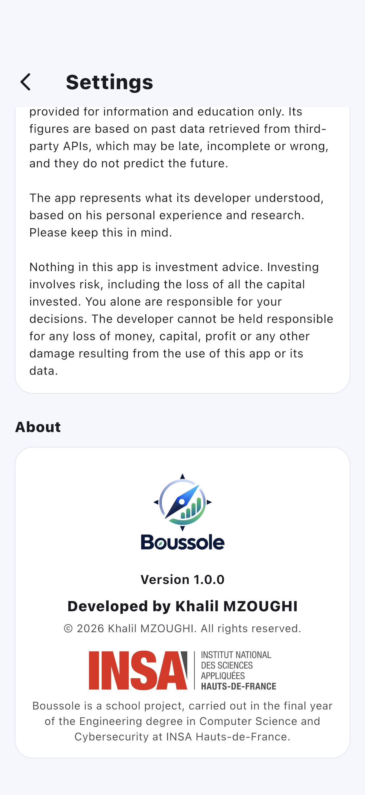<br><sub><b>About</b></sub></td><td align="center" width="25%">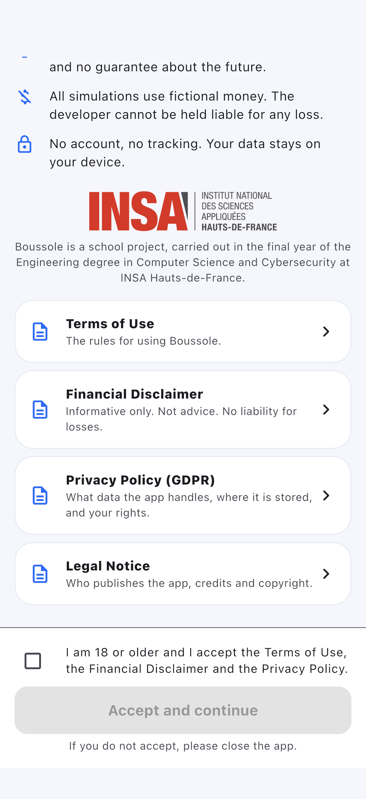<br><sub><b>Documents list</b></sub></td><td align="center" width="25%">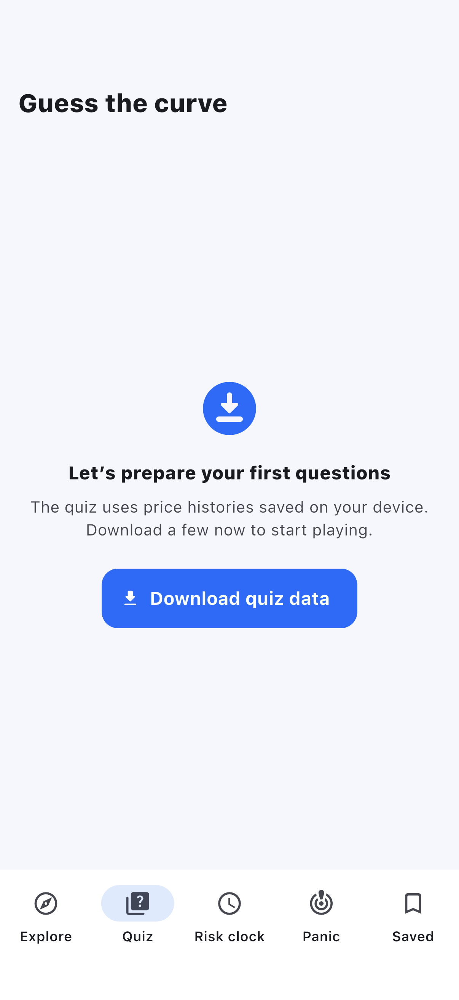<br><sub><b>Quiz: first launch</b></sub></td></tr>
</table>

---

## 3. Features, one by one

The app has five tabs (bottom navigation) plus a settings screen and the legal documents.

### 3.1 First launch: legal gate

Before anything else, the **welcome screen** shows four key points and the four legal documents
(Terms of Use, Financial Disclaimer, Privacy Policy, Legal Notice). The user must tick
*"I am at least 18 and I have read and accept…"* before the **Accept and continue** button is enabled.
The acceptance (version + date) is stored locally. When the legal texts change (`LegalDocuments.version`),
the screen is shown again. The router (`go_router` redirect) makes it impossible to reach any other screen
until the current version is accepted. The documents can be read again in *Settings > Legal and privacy*.

### 3.2 Explore (catalog and asset sheet)

- **Catalog:** the 30 starter assets, loaded from `assets/data/catalog.json` (no network at startup).
- **Search** by name or symbol, **filter** by type (Stock / ETF / Crypto), **favorites** filter.
- **Favorites:** tap the heart (animated bounce). Stored permanently.
- **Hero transition:** the asset badge flies from the list to the detail screen.
- **Asset sheet:** price curve from **1M to 10Y** (touch the chart to read a date and price),
  big price + performance, a **risk badge** (low / moderate / high / very high), three indicators
  (performance, volatility, worst drop), and a plain-English explanation adapted to the asset type
  (a single stock, an ETF, a crypto) and to its numbers.
- **Euro display:** in Settings the user can switch to euros. Prices on asset sheets are then converted with the historical
  USD/EUR rate of each date. The quiz and the Risk clock always work in US dollars (the Risk clock says so); the Panic button uses fictional amounts and percentages.
- The risk badge shows the period it was measured on (for example *Moderate risk · 1Y*), because volatility depends on the period.
- **Data banner:** shows *"Refreshing data…"* or *"Offline: data from 6 Oct 2026 at 18:12"*.
- Every indicator is followed by *"This describes the past. It is not a prediction."*

### 3.3 Quiz: Guess the curve

1. An **anonymous 1-year curve** (rebased to 100, no axis, no name) is shown.
2. The user chooses among **4 assets** (the right one + 3 random others, each with its type).
3. The card **flips in 3D** and reveals the asset, its dates, performance, volatility and worst drop.
4. A correct answer triggers **confetti**. Score (`correct / answered`) and **daily streak**
   (consecutive days with at least one correct answer) are saved.

The quiz **only uses histories already in the local cache**, so it works offline. On a fresh install there is
nothing cached yet, so the screen offers **Download quiz data**: it downloads the weekly history of 6 random assets,
then builds questions from the cache. A question window is a random 52-week slice of the history, so
the same asset gives different curves.

### 3.4 Risk clock

1. The user picks an asset (bottom sheet with the catalog).
2. A **slider** selects the holding period: 1M, 3M, 6M, 1Y, 2Y, 3Y, 5Y, 10Y.
3. A big number shows the **historical probability of ending in loss** after that period
   (colour goes from green to red), and a **histogram** shows all periods at once; bars animate when the slider moves,
   and tapping a bar selects it.
4. If the history is shorter than the chosen period (a young crypto for instance), the bar shows `n/a`
   instead of a wrong number.
5. **Save this simulation** stores the result in *Saved*.

States: *no asset chosen → loading → result displayed → result saved* (plus the error / offline states).

### 3.5 Panic button

1. **Setup** (validated form): choose one of **6 historical crashes** and a fictional amount
   (required, numeric, between 100 and 1,000,000).
2. **Play:** the user starts at the **peak** before the crash, with everything invested.
   Each week the real price moves and the user decides: **Hold**, **Sell all**, **Buy more**
   (the user chooses the amount: a quick pick of 5 / 10 / 25 / 50 % of the starting amount, or any amount typed in a validated field) or, once out of the market, **Stay in cash** (the "Hold" choice renamed) and **Buy back**. A *Hold for 4 weeks*
   button skips quickly through long crashes. The screen shows the price curve so far, the portfolio value,
   the market's drop from its peak and the user's own performance.
3. **Result:** an animated counter (red/green) with the gain or loss, a **progressively drawn chart**
   *"You vs doing nothing"*, the final values, the **returns in %** of both strategies (compared as returns,
   because adding money changes how much was invested, so more money in is not a better decision), the worst market
   drop, the **recovery time** (weeks needed to regain the previous peak, or *"Not yet"*), and a lesson that depends on
   what the user really did and on the return gap: sold, sold then bought back, bought more (at a low or a high price),
   or held.
4. **Save this simulation** or **Try again**.

Crash scenarios (real weekly closes, bundled in `assets/data/`, so no network is needed):

| Scenario | Asset (Yahoo ticker) | Period | Weeks | Worst drop |
|---|---|---|---|---|
| Covid crash 2020 | S&P 500 (`SPY`) | Feb - Dec 2020 | 47 | about -32 % |
| Financial crisis 2008 | S&P 500 (`SPY`) | Oct 2007 - Dec 2009 | 117 | about -56 % |
| Dot-com bubble 2000 | Nasdaq 100 (`QQQ`) | Mar 2000 - Dec 2002 | 148 | about -83 % |
| Crypto winter 2018 | Bitcoin (`BTC-USD`) | Dec 2017 - Apr 2019 | 69 | about -83 % |
| Crypto winter 2022 | Bitcoin (`BTC-USD`) | Nov 2021 - Dec 2022 | 61 | about -75 % |
| Tariff shock 2025 | S&P 500 (`SPY`) | Feb - Aug 2025 | 28 | about -16 % |

### 3.6 Saved (My simulations)

Lists the saved Risk clock and Panic results (newest first). Tap for the details; **swipe left to delete**.
Saved simulations are user data and stay on the device permanently.

### 3.7 Glossary

An in-app **glossary** (book icon in the app bars, and in Settings) explains the jargon in plain English,
grouped as *Assets*, *Reading risk*, *Panic button* and *Data and numbers*. It is searchable, and each term shows a
definition plus **how it appears in Boussole**: stock, ETF, crypto, diversification, performance, volatility, worst drop (drawdown),
recovery time, holding period, chance of loss, hold, **stay in cash**, sell all, **buy more**, buy back, doing nothing,
loss aversion, market timing, raw vs adjusted prices, rebased to 100, exchange rate… (`lib/core/glossary/`).
In the Panic button every choice has a **?** button opening the glossary on that exact term.

### 3.8 Settings

a shortcut to the glossary, *Appearance* (system / light / dark), *Display currency* (USD / EUR), *Data sources*, *Legal and privacy*
(the four documents, open-source licences, acceptance date), *Storage* (clear downloaded prices,
**Delete all my data**), *Important* (not a banking app, informative only, no liability) and *About*
(developer, copyright, INSA context).

---

## 4. Architecture

Layered architecture in three folders, with strict dependency direction:

```
 presentation  ──►  domain  ◄──  data
 (widgets +         (pure Dart:     (Drift database,
  Riverpod          models and       HTTP source,
  providers)        calculations)    repositories)
```

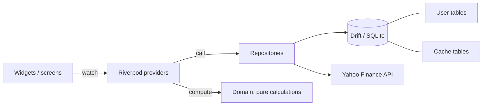

| Layer | Responsibility | Depends on |
|---|---|---|
| `presentation` | Screens, widgets, Riverpod providers and controllers. **No business logic, no network call in widgets.** | domain, data (only through providers) |
| `domain` | Models and **pure functions** (performance, volatility, drawdown, loss probability, Panic simulation, streak). No Flutter import, no I/O. | nothing |
| `data` | `local` (Drift database and stores), `remote` (HTTP), `repositories` (the only classes the app talks to). | domain |
| `core` | Cross-cutting: theme, router, formatters, shared widgets, legal texts, app info. | - |

Answers to the usual design questions:

| Question | Answer |
|---|---|
| Where is the state? | In Riverpod providers (`presentation/providers` and one controller per feature). Never in widgets. |
| Who decides between cache and API? | `MarketRepository`, and only it. |
| Where are the calculations? | `lib/domain/calculations/`, as pure functions, unit-tested. |
| Who persists data? | `UserStore` (user data) and `PriceCacheStore` (API cache), both on top of Drift. |
| How do errors and loading reach the UI? | Providers expose `AsyncValue`; `AsyncValueView` renders loading / data / error + **Retry** consistently. |
| What happens when a widget rebuilds? | Nothing expensive: computations and network calls live in providers, which are not recreated by a rebuild. |

---

## 5. Project structure

```
boussole/
├── assets/
│   ├── images/            logo.png, logo-text.png, insa-logo.png
│   └── data/              catalog.json (30 assets) + crash_*.json (6 crash histories)
├── docs/                  project statement and proposal (PDF) + screenshots/
├── test/                  unit and widget tests
└── lib/
    ├── main.dart          entry point (portrait lock, ProviderScope)
    ├── app.dart           MaterialApp.router, theme mode
    ├── core/
    │   ├── config/        app_info.dart (name, version, developer, school)
    │   ├── glossary/      glossary_entries.dart (definitions of the jargon)
    │   ├── legal/         legal_documents.dart (Terms, Disclaimer, Privacy, Notice)
    │   ├── router/        app_router.dart (go_router, legal redirect)
    │   ├── theme/         colors, spacing, Material 3 theme (light + dark)
    │   ├── utils/         formatters (dates, percent, money)
    │   └── widgets/       shared UI: cards, stat tiles, banners, state views,
    │                      charts/ (PriceLineChart, DrawnLineChart), animations/
    ├── domain/
    │   ├── models/        Asset, PricePoint, PriceHistory, AssetAnalysis, RiskLevel,
    │   │                  QuizQuestion, QuizStats, SavedSimulation, CrashScenario
    │   └── calculations/  performance, volatility, drawdown, loss_probability,
    │                      panic_simulation, series_utils, streak
    ├── data/
    │   ├── local/         database.dart (Drift), price_cache_store.dart, user_store.dart
    │   ├── remote/        price_source.dart (interfaces), yahoo_finance_source.dart, http_helpers.dart
    │   └── repositories/  market, user, settings, catalog
    └── presentation/
        ├── providers/     infra (wiring, settings, legal), market (history, asset view), user
        ├── shell/         bottom navigation
        ├── catalog/       list, filters, tiles
        ├── asset_detail/  asset sheet
        ├── quiz/          controller + screen
        ├── risk_clock/    controller + screen + histogram + asset picker
        ├── panic/         controller + setup / play / finished views
        ├── glossary/      glossary screen
        ├── simulations/   saved simulations
        ├── settings/      settings and about
        └── legal/         welcome (acceptance) + document viewer
```

**Main packages:** `flutter_riverpod` (state), `go_router` (navigation), `drift` + `drift_flutter` +
`sqlite3_flutter_libs` (SQLite), `http` (network), `fl_chart` (charts), `intl` (formatting), `equatable`.
Dev: `drift_dev`, `build_runner`, `flutter_launcher_icons`.

---

## 6. State management (Riverpod)

Riverpod was chosen because `AsyncValue` natively represents the states of an asynchronous operation and providers
are testable without any UI.

**Infrastructure providers** (`infra_providers.dart`): `databaseProvider`, `httpClientProvider`, the stores,
the repositories, `marketRepositoryProvider`, `settingsProvider` (`AsyncNotifier`) and `legalProvider`
(`AsyncNotifier`, legal acceptance).

**Data providers** (`market_providers.dart`):

| Provider | Type | Role |
|---|---|---|
| `catalogProvider` | `FutureProvider` | The 30 assets from the bundled JSON |
| `historyProvider((asset, granularity))` | `StreamProvider.family` | Emits the cached history first, then the refreshed one |
| `usdEurRatesProvider` | `StreamProvider` | USD/EUR rates for euro display |
| `chartRangeProvider` | `Notifier` | Selected range on the asset sheet (1M…10Y) |
| `assetViewProvider((asset, range))` | `Provider.family` | History cut to the range, converted to EUR if needed, plus `AssetAnalysis` indicators |
| `favoritesProvider`, `simulationsProvider` | `StreamProvider` | Live views of the user tables (Drift `watch`) |

**Feature controllers:** `QuizController` (`AsyncNotifier`), `RiskClockController` (`Notifier`) +
`riskClockResultProvider`, `PanicController` (`Notifier`), `CatalogFilterNotifier`.

**Asynchronous states** (every history, sheet or question): initial → loading → data → *data but old (offline)* →
*refreshing in background* → error with **Retry**. `HistoryStatus` (`fresh` / `refreshing` / `stale`) carries the
last three; Riverpod's `AsyncLoading` / `AsyncError` carry the others. Automatic retries are disabled
(`ProviderScope(retry: …)`): the user decides with the Retry button.

**Business states:**

| Module | States |
|---|---|
| Catalog | favorite or not; empty or filled favorites list |
| Quiz | question shown → answer chosen → revealed (correct / wrong); streak running or broken; not enough data |
| Risk clock | no asset → computing → result → saved |
| Panic button | not configured → playing (week N) → finished with result → saved |
| Legal | unknown (splash) → not accepted (welcome) → accepted |

---

## 7. Data: where it comes from

### 7.1 One API: Yahoo Finance (no key)

To keep the app simple and usable by anyone, **a single external API** is used, and it needs **no API key and no account**:
the Yahoo Finance *chart* endpoint.

```
GET https://query1.finance.yahoo.com/v8/finance/chart/{TICKER}?interval={1d|1wk}&range={1y|10y}
GET https://query1.finance.yahoo.com/v8/finance/chart/{TICKER}?interval=...&period1={unix}&period2={unix}
```

| Use | Ticker | interval / range | Used for |
|---|---|---|---|
| Stocks and ETFs | `AAPL`, `SPY`, `VT`… | weekly (`1wk`) over `10y` | Asset sheet 6M-10Y, quiz, Risk clock |
| Stocks and ETFs | same | daily (`1d`) over `1y` | Asset sheet 1M and 3M |
| Cryptocurrencies | `BTC-USD`, `ETH-USD`… (crypto symbol + `-USD`) | same as above | Same as above |
| Exchange rate | `EURUSD=X` (USD per 1 EUR) | daily over `10y` | Euro display: the app uses `1 / rate` (EUR per USD) |

- **Incremental refresh:** when data is already cached, the request uses `period1` (last cached date minus 7 days) and
  `period2` (tomorrow), so only the missing part is downloaded, then merged.
- **Parsing:** `YahooFinanceSource.parse` converts the JSON (`timestamp[]` and `indicators.quote[0].close[]`) into
  `PricePoint` objects (date + close). Null closes are skipped, and there is one point per date.
- **Errors** become an `ApiException` with a readable message (no connection, timeout, HTTP 429, "no data for this symbol").
- Prices are **raw closing prices**: they are not adjusted for dividends and stock splits, which can **understate
  some performances**. This is stated in the app.
- **Limit:** this is an unofficial, undocumented endpoint. It may change or be rate-limited; the app then shows the
  cached data and an *offline* banner. The source is isolated behind the `PriceSource` and `RatesSource`
  interfaces, so another provider can replace it by writing one class.

### 7.2 Bundled data (no network)

| File | Content |
|---|---|
| `assets/data/catalog.json` | The 30 catalog assets (symbol, name, type, educational description). Loaded without any network call. |
| `assets/data/crash_*.json` | Real **weekly closing prices** of the six crashes, downloaded once from the same Yahoo endpoint. Used by the Panic button. |

### 7.3 The 30-asset catalog


**Stocks (10)**

| Symbol | Yahoo ticker | Name | Why it is in the catalog |
|---|---|---|---|
| AAPL | `AAPL` | Apple | Maker of the iPhone, Mac and a large services business. A mega-cap tech company. |
| MSFT | `MSFT` | Microsoft | Software and cloud giant behind Windows, Office and Azure. |
| NVDA | `NVDA` | NVIDIA | Designs the chips that power gaming and AI. Strong growth, large swings. |
| AMZN | `AMZN` | Amazon | E-commerce and cloud computing (AWS) leader. |
| GOOGL | `GOOGL` | Alphabet | Parent of Google and YouTube; revenue mostly from advertising. |
| TSLA | `TSLA` | Tesla | Electric vehicles and energy storage. Famous for sharp price moves. |
| JNJ | `JNJ` | Johnson & Johnson | Healthcare group (pharma and medical devices). A classic defensive stock. |
| KO | `KO` | Coca-Cola | Global beverage brand with steady revenue and regular dividends. |
| JPM | `JPM` | JPMorgan Chase | Largest US bank. Its price follows the economic cycle closely. |
| WMT | `WMT` | Walmart | World's largest retailer. Stable demand, even in downturns. |

**ETFs (10)**

| Symbol | Yahoo ticker | Name | Why it is in the catalog |
|---|---|---|---|
| SPY | `SPY` | SPDR S&P 500 ETF | Tracks the 500 largest US companies in a single fund. |
| QQQ | `QQQ` | Invesco QQQ (Nasdaq 100) | Tracks 100 big Nasdaq companies, heavy on technology. |
| VTI | `VTI` | Vanguard Total US Market | Owns almost the entire US stock market, from large to small caps. |
| VT | `VT` | Vanguard Total World | Thousands of companies across the world in one fund. Maximum diversification. |
| VEA | `VEA` | Vanguard Developed Markets | Companies from Europe, Japan and other developed countries outside the US. |
| EEM | `EEM` | iShares Emerging Markets | Companies from emerging countries such as China, India and Brazil. |
| IWM | `IWM` | iShares Russell 2000 | US small caps: smaller companies, usually more volatile than large ones. |
| AGG | `AGG` | iShares Core US Bonds | A basket of US bonds. Typically calmer than stocks, with lower growth. |
| GLD | `GLD` | SPDR Gold Shares | Follows the gold price. Often seen as a safe haven in uncertain times. |
| VNQ | `VNQ` | Vanguard Real Estate | Listed real-estate companies (offices, housing, warehouses). |

**Cryptocurrencies (10)**

| Symbol | Yahoo ticker | Name | Why it is in the catalog |
|---|---|---|---|
| BTC | `BTC-USD` | Bitcoin | The first and largest cryptocurrency. Digital, scarce, and very volatile. |
| ETH | `ETH-USD` | Ethereum | A programmable blockchain used for apps and tokens. |
| SOL | `SOL-USD` | Solana | A fast blockchain for apps. Young, ambitious and highly volatile. |
| BNB | `BNB-USD` | BNB | The token of the Binance ecosystem. |
| XRP | `XRP-USD` | XRP | A crypto designed for fast cross-border payments. |
| ADA | `ADA-USD` | Cardano | A research-driven blockchain platform. |
| DOGE | `DOGE-USD` | Dogecoin | Started as a joke; moves mostly with social media hype. |
| AVAX | `AVAX-USD` | Avalanche | A blockchain for apps focused on speed and low fees. |
| DOT | `DOT-USD` | Polkadot | Connects different blockchains together. |
| LINK | `LINK-USD` | Chainlink | Feeds real-world data to blockchains. |

The catalog covers the three families a beginner meets: single stocks (company risk), ETFs
(diversified baskets, including bonds and gold) and cryptocurrencies (very volatile). This mix is on purpose:
it is what makes the quiz and the risk indicators meaningful.

---

## 8. Data: how it is stored

Persistence uses **SQLite through Drift** (typed queries, reactive `watch` streams, easy to test with an in-memory database).
Two groups of tables are kept **separate**, so that what is precious is never confused with what can be downloaded again.
The database file is `boussole.sqlite`, in the private storage of the app.

### 8.1 User data (permanent)

| Table | Columns | Content |
|---|---|---|
| `favorites` | `symbol` (PK), `added_at` | Favorite assets |
| `simulations` | `id` (PK, auto), `kind` (`riskClock` / `panic`), `title`, `payload` (JSON map of label → value), `created_at` | Saved Risk clock and Panic results |
| `quiz_stats_rows` | `id` (always 1), `correct`, `answered`, `streak`, `best_streak`, `last_played` | Quiz score and daily streak |
| `preferences` | `key` (PK), `value` | `themeMode`, `currency`, `legalVersion`, `legalAcceptedAt` |

### 8.2 API cache (can be downloaded again)

| Table | Columns | Content |
|---|---|---|
| `cached_prices` | `symbol`, `granularity` (`daily` / `weekly`), `date`, `close` (PK on the three first) | One row per price point. The USD/EUR rate is stored under the pseudo-symbol `FX:USD-EUR`. |
| `cache_meta` | `symbol`, `granularity` (PK), `fetched_at` | When the series was last downloaded |

Schema version is **1** (first release).

### 8.3 What is *not* stored

No account, no email, no identifier, no analytics. Everything stays on the device. *Settings > Delete all my data* erases
all tables above.

---

## 9. Cache strategy and offline mode

`MarketRepository` is the only place that knows whether data comes from the cache or the network. For each
`(symbol, granularity)`:

```
read cache + meta
if cache is fresh (daily < 24 h, weekly < 7 days) and not forced
    emit cached data (status = fresh), no network call
else
    if cache not empty: emit cached data (status = refreshing)
    try
        download only the missing part (since = last cached date)
        merge into the cache (upsert by date), update fetched_at
        emit merged data (status = fresh)
    on failure
        if cache empty: emit an error (screen shows Retry)
        else: emit cached data (status = stale) + error message (banner shows last update date)
```

**Justification:** a daily series changes every day, a weekly series only once a week, hence 24 h and 7 days.
Fetching only the missing part keeps transfers small and avoids hammering the provider. Showing the old data immediately
(*stale-while-revalidate*) keeps the app responsive.

**Offline behaviour (works after fully closing the app and disabling the network):**
- favorites, saved simulations, quiz score and streak: available (local tables);
- asset sheets already visited: available, with a banner *"Offline: data from 3 Nov 2026 at 15:02"*;
- quiz: builds questions only from cached weekly histories;
- Panic button: fully available (bundled data);
- an asset never downloaded while offline: error with **Retry**.

The unit tests check this with a fake API: no network call when the cache is recent, merge of missing data,
stale emission when offline, forced refresh.

---

## 10. Business calculations

All are **pure functions** in `lib/domain/calculations/` (no Flutter, no I/O), each unit-tested with edge cases.

| Calculation | File | Principle | Edge cases handled |
|---|---|---|---|
| **Performance** | `performance.dart` | `(final - initial) / initial × 100` | initial ≤ 0 → `null` |
| **Volatility** | `volatility.dart` | Sample standard deviation of periodic returns × √(periods per year), in %. Periods per year are deduced from the dates, so the same function serves daily and weekly data | < 2 returns → `null`; zero previous price skipped |
| **Maximum drawdown** | `drawdown.dart` | Largest fall from a peak to the lowest point after it. Also returns the peak, trough and **recovery index** (recovery time) | empty / single point → `null`; zero prices ignored; never recovered → `null` |
| **Probability of loss** | `loss_probability.dart` | For a holding period of N months, every possible start date is taken; the end price is the first one on or after start + N months; the result is the **share of windows ending below the start price** | horizon longer than history → `null`; empty history; invalid duration |
| **Panic button result** | `panic_simulation.dart` | Immutable simulation: units + cash, weekly actions (hold / sell / buy more / buy back); compared to the *"do nothing"* baseline | amount ≤ 0, < 2 prices, first price ≤ 0 rejected; unavailable action throws; stepping a finished run is a no-op |
| **Quiz streak** | `streak.dart` | Consecutive days with at least one correct answer | same day / next day / gap / wrong answer |
| **Series helpers** | `series_utils.dart` | Rebase to 100, last N months, USD→EUR conversion with the latest known rate on or before each date | empty rates → unchanged |

Example from the project statement: `100 → 110 → 125 → 115 → 90 → 105` has a peak of 125, a trough of 90 and a maximum drawdown of
`(90 - 125) / 125 = -28 %` (this is a unit test).

**Risk level** (`risk_level.dart`) classifies annualised volatility: `< 12 %` low, `< 25 %` moderate, `< 45 %` high, otherwise very high.
It is a teaching label, not a rating.

---

## 11. Animations

Each animation reveals information at the right time rather than decorating the screen.
**Six are coded by hand** (controller / tween / painter), one is provided by Flutter.

| Animation | Where | Implementation | Purpose |
|---|---|---|---|
| 3D card flip | Quiz | `AnimationController` + `AnimatedBuilder` + `Matrix4.rotateY` (`flip_card.dart`) | Marks the move from guessing to explaining |
| Progressive curve drawing | Panic result | `CustomPainter` driven by a 0→1 animation, `PathMetric.extractPath` (`drawn_line_chart.dart`) | The fall and the rebound unfold like in real time |
| Counting result | Panic result | `TweenAnimationBuilder`, green/red by sign (`animated_counter.dart`) | Makes the gap between holding and selling tangible |
| Animated histogram bars | Risk clock | `TweenAnimationBuilder` on each bar height and on the big percentage | Shows the loss probability shrinking as time grows |
| Confetti | Quiz (correct answer) | `CustomPainter` particles with gravity (`confetti.dart`) | Rewards regularity |
| Favorite heart bounce | Catalog, asset sheet | `AnimationController` + `TweenSequence` scale (`favorite_button.dart`) | Feedback on add to favorites |
| Hero transition | Catalog → asset sheet | Flutter `Hero` on the asset badge | Visual continuity |

Charts: `fl_chart` for the price curves and the quiz curve, `CustomPainter` for the animated portfolio chart.

---

## 12. Tests

```
flutter test                 # unit + widget tests
```

| Test file | What it covers |
|---|---|
| `test/domain/calculations_test.dart` | performance, drawdown (statement example -28 %, recovery, empty/single/zero), volatility, probability of loss, rebase, weekly resample, EUR conversion |
| `test/domain/panic_simulation_test.dart` | hold = baseline, selling at the bottom, buying the dip, buy-back, user-chosen amount, **returns compared instead of values**, invalid actions and starts, series replay |
| `test/domain/streak_test.dart` | streak rules |
| `test/domain/crash_scenarios_test.dart` | every bundled crash file is valid and really contains a fall of at least 15 % |
| `test/domain/legal_test.dart` | legal documents exist and are not empty |
| `test/domain/glossary_test.dart` | glossary ids unique, entries filled, every Panic action explained |
| `test/data/market_repository_test.dart` | repository with a **fake API** and an in-memory database: first download, **no network call when the cache is recent**, weekly vs daily freshness, refresh and merge (`since` is passed), stale data when offline, error without cache, forced refresh |
| `test/data/yahoo_source_test.dart` | Yahoo JSON parsing, nulls, duplicates, API errors, ticker mapping |
| `test/presentation/widgets_test.dart` | error view with working Retry, stat tile |

---

## 13. Legal and privacy

The app contains four documents (`lib/core/legal/legal_documents.dart`), accepted at first launch and readable in Settings:

| Document | Content |
|---|---|
| **Terms of Use** | Purpose, school project, what the app is and is not, eligibility (18+), acceptable use, third-party data, intellectual property, no warranty, limitation of liability, governing law (France) |
| **Financial Disclaimer** | Information only, the author's understanding, the past does not predict the future, simulations are fictional, third-party data, risk warning, no liability for any loss |
| **Privacy Policy (GDPR)** | Controller, data stored on the device only, requests sent to Yahoo Finance (IP address and ticker), what is not collected, rights (access, erasure, portability…), CNIL, security, minors |
| **Legal Notice** | Publisher, academic context (INSA is not the publisher), copyright, credits |

Key points: no account, no tracking, no analytics, no server operated by the developer; *Delete all my data* in Settings exercises
the right to erasure; the developer cannot be held liable for any loss. These texts are a careful template written for a school project;
have them reviewed by a legal professional before any public release. Set `AppInfo.contactEmail` (`lib/core/config/app_info.dart`) with a contact address before publishing.

---

## 14. Run, build and test

Requirements: Flutter 3.47+ (Dart 3.13+). **No API key and no account are needed.**

```bash
flutter pub get
dart run build_runner build --delete-conflicting-outputs   # generates the Drift code
flutter run                                                # phone or emulator (portrait only)
flutter test                                               # unit and widget tests
flutter analyze

# regenerate the launcher icons from assets/images/logo.png:
dart run flutter_launcher_icons
```

The app is **phone only** (iPhone and Android phones, portrait).

---

## 15. Design choices, limits and future work

**Choices and why**
- *Riverpod*: `AsyncValue` models loading/data/error out of the box, and providers are testable without UI.
- *Drift/SQLite*: typed queries, reactive streams, and a clean separation of user tables from cache tables.
- *One keyless API*: simplest for users and for the demo; the provider sits behind an interface.
- *Pure domain layer*: every calculation is testable in isolation and shows up in the report as a function, not as UI code.
- *Weekly data for long ranges*: enough for 10 years of analysis and much lighter than daily data.
- *Bundled crash data*: the Panic button works offline and is reproducible.

**Limits**
- The Yahoo endpoint is unofficial and may change or throttle requests; the app degrades to cached data.
- Raw prices are not adjusted for dividends and splits, which can understate some performances.
- Some cryptos have short histories (for example DOT, AVAX), so long Risk-clock periods show `n/a`.
- Simulations ignore fees, taxes, spreads and liquidity, and decisions are weekly at closing prices.
- A probability of loss is computed from overlapping windows of a single history: it is an illustration, not a statistical forecast.
- The explanations and rules reflect the developer's own understanding and research.

**Possible improvements:** a second data provider as a fallback, DCA simulator (monthly investing), explainable asset score
(Nutri-Score style), more crash scenarios, dark-mode variant of the school logo, localisation (French), and a CI pipeline running tests and analysis.

---

<p align="center">© 2026 Khalil MZOUGHI. All rights reserved.<br>
School project, INSA Hauts-de-France. Educational use only, not financial advice.</p>
